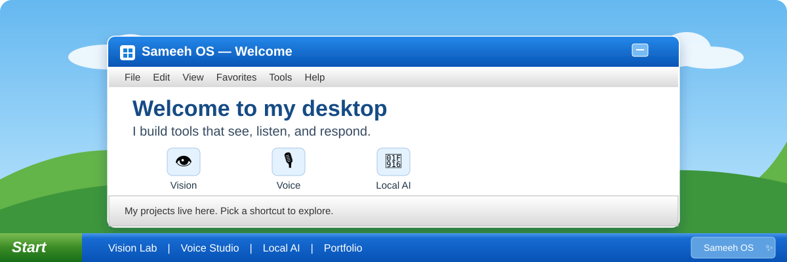
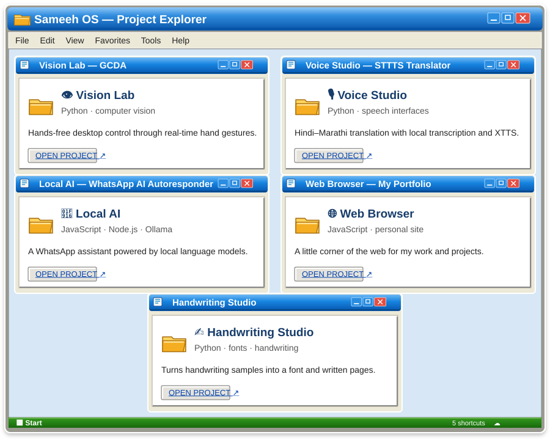

### Welcome to my desktop 👋
**Sameeh Sayed** · developer building with **vision, voice & local AI**

---

<table>
<tr><td colspan="2"><b>🪟 ABOUT.TXT — a little about me</b></td></tr>
<tr>
<td width="62%">

I like making computers feel a little more capable and a lot more useful. Lately, that means building tools that understand **hand gestures**, work with **speech**, and run **AI locally**.

</td>
<td width="38%">

**CURRENT MODE** 
🟢 Building & learning 
📍 India 
💬 Python · JavaScript

</td>
</tr>
</table>

## 🖥️ My Computer — double-click a project

**Open a project:** [👁️ GCDA](https://github.com/SayedSameeh/GCDA) · [🎙️ STTTS Translator](https://github.com/SayedSameeh/STTTS-Translator) · [🤖 WhatsApp AI Autoresponder](https://github.com/SayedSameeh/whatsapp-ai-autoresponder) · [🌐 Portfolio](https://github.com/SayedSameeh/sameeh-portfolio)

## 🧰 Control Panel — tools I reach for

<table>
<tr><td><b>⚙️ My current interests</b></td><td>Computer vision · Speech interfaces · Local AI</td></tr>
<tr><td><b>🧪 Currently exploring</b></td><td>Making software more natural to use</td></tr>
</table>

## 📊 Task Manager — system monitor

---

🟩 **START**　　[📁 Projects](#-my-computer--double-click-a-project)　　[⚙️ Control Panel](#-control-panel--tools-i-reach-for)　　[🌐 Portfolio](https://github.com/SayedSameeh/sameeh-portfolio)

Thanks for stopping by my desktop. Have a great day! ☁️

